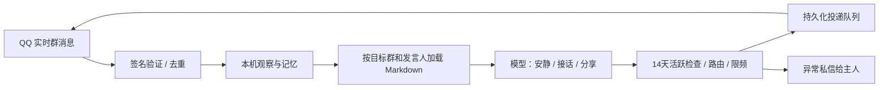

# 🪨 QQ Surf Agent

一个有离线记忆的 QQ 群友型 bot：观察消息、按需读取群与成员记忆，决定保持安静、自然接话，或分享隔壁群的新素材。

Python 3.9+，主程序使用标准库，ChatGPT 登录验证额外使用 PyJWT。通过本机 OneBot 11 HTTP 服务接入 QQ；模型支持 Chat Completions 兼容接口和官方 ChatGPT 订阅授权。

## 消息流程



只由消息驱动发言决策，没有定时主动发帖器。定时工作仅用于记忆 flush、队列处理、连接检查和异常恢复。

## 本机记忆

```text
context/                         # 整个目录被 Git 忽略
  groups/<group_id>/group.md      # 群习惯、近期话题、人工补充
  people/<user_id>/people.md      # 成员兴趣与表达观察
  self/persona.md                 # bot 自己的人设及样本统计
  memory.sqlite3                 # 增量观察与 flush 检查点
runtime/                         # 数据库、日志、PID、停止请求；也被忽略
```

每次模型请求只读取本次相关的 persona、group、people 片段，以及目标群最近几条消息；不把完整聊天历史持续累积在在线 conversation 中。没有 previous_response_id 或服务端会话依赖。

- 活跃会话的 Markdown 默认每60秒更新一次；连续5分钟无相关活动时立即写回并释放会话，可执行 `python3 botctl.py flush` 立即写回。
- 每群最多保留200条观察，样本保留30天；原始工作上下文保留48小时。
- Markdown 自动生成区有明确标记，区外的人工补充会保留。
- 人设保持 bot 身份，不冒充某位真实群友。样本少时写明不确定性。
- 当前自动画像主要提取句长、常见词、带图比例；不是对性格、身份等作心理学推断。
- 每次召回的离线文件总计最多4500字符，近期目标群最多6条，每条300字符；另附最多4个候选。

## 启动

1. 安装并登录提供 OneBot 11 的 QQ 桥接程序，例如 [NapCatQQ](https://napneko.github.io/guide/boot/Shell)。本项目不自动安装或修改 QQ。
2. 把 `config.example.json`、`workflow.example.json`、`llm.example.json` 分别复制为 `config.json`、`workflow.json`、`llm.local.json`。
3. 配置 bot 账号、群列表、主人 QQ 号、访问令牌，以及模型密钥。所有真实配置文件都被 Git 忽略。
4. 启用桥接 HTTP 服务，绑定 `127.0.0.1`；默认端口3000，关闭CORS并配置Token。
5. 启用桥接 HTTP 客户端，上报 `http://127.0.0.1:8767/events`，消息格式Array，Token与本项目连接Token一致，关闭上报自身消息。
6. 运行：

```bash
python3 botctl.py bootstrap      # 只观察近14天内可读取样本，不创建历史投递任务
python3 botctl.py model-check    # 一条无真实群聊的模型连通性测试
python3 supervisor.py            # 单实例守护，异常退出退避重启
```

macOS 也可以双击 `start.command`。`python3 botctl.py stop` 请求停止守护进程。默认没有安装系统登录自启；电脑关机、休眠或 QQ 退出时，不能继续正常处理消息。

配置内容和模型密钥可以修改后保存，工作周期会重新读取；改变端口、数据库路径或桥接Token后应重启服务。`context_dir` 建议使用绝对路径；示例中的相对路径在项目目录运行时有效。

## 发言规则

- 目标群最近14天没有其他成员消息，或者没有可靠活跃记录：保持安静。
- bot 自己的消息不会更新群活跃时间。发送前再次检查活跃状态，隔壁群触发不能绕过。
- 不批量回放历史。bootstrap只学习本机记忆；实时事件超过5分钟不投递。
- 普通聊天也能触发判断，但模型可以选择wait；相邻群的消息只影响近期活跃的目标群。
- 原始素材与成员身份不会直接拼进系统指令。模型不拥有系统命令或自由工具调用权限。
- 模型给出的收件群会被忽略，回复只能发送到代码固定的目标群；分享只能选择本次给出的候选及既定路由。
- 素材指纹、每群已见记录、bot身份、搬运标记共同防止群间回环。同图换文案也会去重。
- 默认预览模式不发送。确认模型正常后，把workflow的mode设为live；只有approved的投递会真正发送。
- 每群/全局每日上限、回复冷却、分享冷却均可配置。发送结果不确定时不自动重复发送。

## 模型接入

本机模型配置支持环境变量 `OPENAI_API_KEY`、配置文件中的api_key，或api_key_file。不要提交真实密钥。

OpenAI临时配置可使用有访问权限的低价模型。示例保留gpt-5-nano，它已在官方标注Deprecated，实际可用性应以账号和模型列表为准，不会静默换成更贵的模型。OpenAI请求使用max_completion_tokens，不发送temperature。切换兼容服务时把provider设为compatible，填写其base_url、model和密钥。

标准API key按API项目计费，ChatGPT Plus不会直接变成该key的余额。额度不足会暂停30分钟并通知主人，不持续重试。

支持官方 [Sign in with ChatGPT](https://developers.openai.com/siwc/token-sharing-open-source) 订阅用量接入，实际权限以授权结果为准，与该账号其他订阅使用共享限额：

```bash
python3 -m pip install --target runtime/deps -r requirements-chatgpt.txt
python3 chatgpt_auth.py login
# 在系统浏览器打开 http://127.0.0.1:8768，点击 Continue with ChatGPT 并授权
python3 chatgpt_auth.py models
python3 chatgpt_auth.py activate --model <目录中的模型slug>
```

activate 会先使用无群聊数据的请求验证模型，成功后才切换 llm.local.json。登录支持PKCE、state、nonce、JWKS签名与身份校验、独立账号注册记录、原子0600凭据保存和自动轮换refresh token。重新登录默认使用当前注册；添加另一账号可用 login --new。凭据及旧模型配置只存在被忽略的runtime/chatgpt/。不会读取Codex或浏览器的登录凭据。推理仅调用公共/v1/responses，store=false、stream=true，必须完整收到response.completed才采用结果。登录与激活后应重启旧服务以加载新代码。

max_requests_per_day设为null可取消模型每日次数上限；未配置时仍默认60次，失败也计入上限。发言冷却、事件合并、群消息发送上限和错误退避独立生效。模型额度由订阅限额或供应商预算控制。

usage_report.enabled开启后，常驻服务每10800秒向alerts.owner_qq发送本期调用成功/失败次数、已返回的输入/输出token及近24小时汇总。窗口保存在数据库，重启不重置；停机期间跨过多期仅补一份汇总，QQ离线恢复后只保留最新待发快照。统计包括服务内聊天、入群蒸馏和Codex排障；不含账号其他应用的使用，不是Plus剩余额度。失败请求未返回的token无法计入。

## 异常私信

alerts.owner_qq指定唯一私信收件人，必须是bot能联系到的账号。模型异常、QQ离线、投递失败、工作周期异常写入持久化告警队列，同类通知默认30分钟内合并。QQ连接拒绝时先保存在本机，恢复后补发；通知中不含密钥或聊天原文。网络超时导致通知发送结果不明确时，保留uncertain状态而不盲目重发。

宿主电脑停止运行时，进程本身无法即时通知；恢复后才能继续。守护程序的日志、数据库和记忆都只保存在本机。

diagnostics.enabled开启独立Codex旁路进程：告警进入后按同类故障默认一小时合并，单任务运行、180秒超时，结果落到runtime/diagnostics并给主人发简短归因。代码快照、固定服务日志和状态计数打包给Codex；不把真实配置、群聊数据库或密钥复制进快照。Codex使用本应用自己的ChatGPT授权、隔离CODEX_HOME和公共Responses接口，模型默认gpt-6-luna，read-only沙箱。它提供归因和修复建议；不会修改在线代码或自动执行建议。旁路结果和旁路自身故障不会递归触发排障。

onboarding.enabled开启加入群发现：每60秒检查bot已加入的群，新增群自动加入监听范围。每群初始化一次，扫描成员账号与本机其他群样本/成员列表的交集，读取最多100条30天内可见历史，使用最多40条脱敏文字样本蒸馏群画像，写入group.md的独立入群观察区。无法访问的记录明确标记缺失；历史不进入回复或搬运队列。新发现群完成初始化后介绍一次AI身份、当前配置模型和石头人设；未知活跃度或14天沉寂时不发言。已有配置群作为基线只扫描、不重复介绍。成员交集只表示同一账号出现过，不推断真实身份或私交。

## 检查与验证

```bash
python3 botctl.py status
python3 workflow.py pending
python3 workflow.py inbox
python3 -m unittest discover -s tests -v
```

测试覆盖签名、账号核对、目标绑定、重复事件、跨群已见、图片去重、Markdown写回、召回长度、模型异常退避、每日限额、14天沉寂群保护和告警合并。服务HTTP健康检查：`http://127.0.0.1:8767/health`。

`agent.py`保留独立RSS/Atom采集与本地导入功能；`workflow.py`是群间消息服务，`social.py`是群友交互决策，`memory.py`是离线记忆，`alerts.py`是异常通知，`supervisor.py`负责守护。

## 仓库内容

Git只提交代码、测试、空白示例和说明。context/、runtime/、真实配置、密钥、数据库、收件箱、日志均在.gitignore中；提交前还应检查git ls-files，防止曾被跟踪的私密文件进入历史。

## 短任务与会话生命周期

每条消息持久化为待阅读任务，目标群在代码中固定，不按@或相关性筛选。模型调用默认最高0.2 QPS（至少间隔5秒），同一目标群的待读消息按时间顺序合成一个ReactionAgent请求，默认最多30条、12000字符；超出部分留在队列，不会用最后一条覆盖前面的消息。成功后整批标记已读，失败则整批保留待重试。无自由工具权限。每群有隔离的GroupSession，工作上下文默认最多12条、3000字符，按发言人懒加载相关Markdown，内存最多缓存8名成员的召回结果。

每次请求包含所有本批未读消息和有限历史。人工暂停期间继续阅读但不发送；积压消息仍会读，但超过回复时限不再补发旧回复。称呼不固定为石头，人设是公开说明AI身份的普通群友，喜欢搬屎、接梗和闲聊。

活跃时每60秒写回context；目标会话连续300秒没有活动时，将最近片段写入该群group.md，flush成员与人设记忆，并从SessionPool删除。下次消息触发重新加载离线记忆。模型请求本身保持无状态；这里的sub-agent是服务内的短任务，不是每条消息拉起一个完整OS进程。

## QQ 抢话 CLI

常驻服务与人工终端分开。双击 `QQ抢话.command` 进入当前目标群；直接输入一行就会以bot账号发送。也可在终端使用：

```bash
python3 qq.py groups
python3 qq.py chat
python3 qq.py say "群名关键词" "我来接话"
python3 qq.py say "群名关键词" "只预览" --dry-run
python3 qq.py dm "发给主人"
python3 qq.py pause "群名关键词" 5
python3 qq.py resume "群名关键词"
```

交互终端支持 `/groups`、`/use 群名`、`/pause 5`、`/resume` 和 `/quit`。退出终端不停止服务。手动群发言后自动暂停本群bot发言5分钟；暂停期间的旧反应任务不再补答。手动发送也受14天不挖坟规则保护。已在网络途中的一条消息无法靠暂停撤回。私信命令固定发给主人账号。
